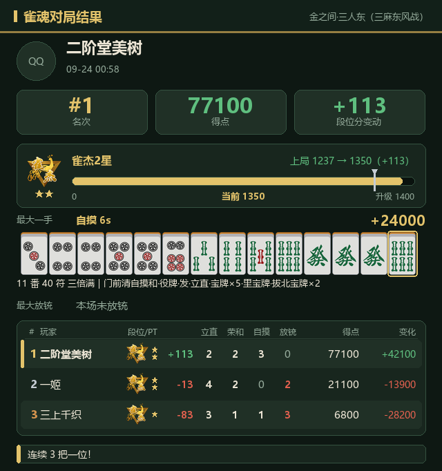
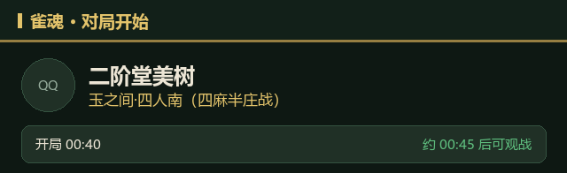
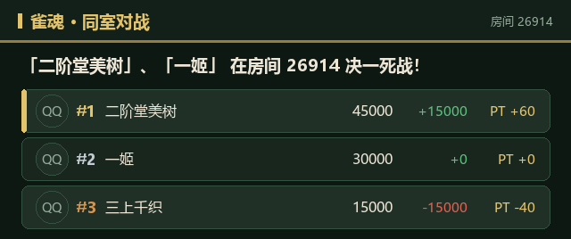
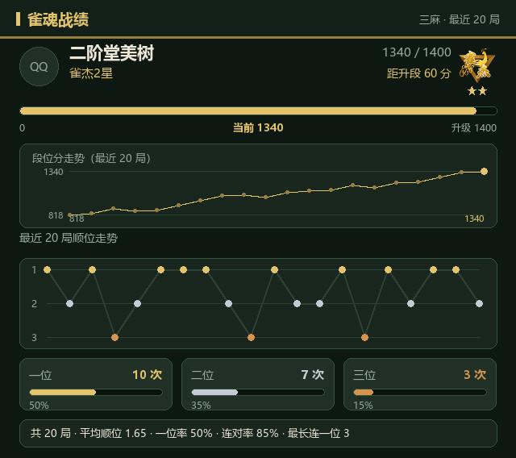
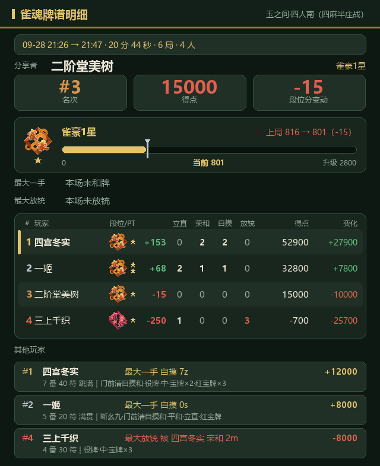
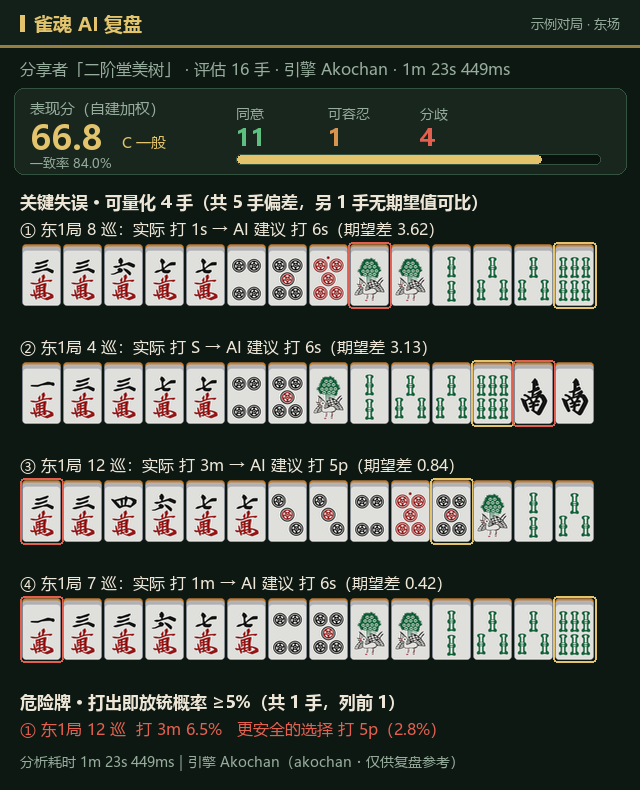

# majsoul-tracker

在 QQ 群里自动播报群友的**雀魂（Majsoul）**对局 —— 对局结果卡片、实时状态、牌谱明细与 AI 复盘。

群友自助绑定雀魂账号后，机器人会主动播报对局结果、开局提示与同室对战，并支持按命令查询战绩、
牌谱明细与逐手 AI 复盘。

> 数据来自雀魂官方协议（无公开 API，本插件为逆向实现）+ 第三方牌谱 API 作为降级。
> **非官方项目**，与猫粮工作室 / 雀魂官方无任何关联。

---

## 功能一览

| 类型 | 能力 | 触发方式 |
| --- | --- | --- |
| 📊 **对局结果卡** | 顺位 / 得点 / PT / 段位 + 最大一手全手牌 + 全玩家统计表 | 群友对局结束**自动推送** |
| 🎬 **开局提示** | 「xxx 开始了 玉之间·四人南（约 5 分钟后可观战）」 | 群友开局**自动推送** |
| ⚔️ **同室对战播报** | 同群多人进入同一好友房 → 「决一死战！」 | **自动** |
| 🟢 **上下线通知** | 好友上线 / 下线提示（带节流，防反复掉线刷屏） | **自动** |
| 📈 **战绩查询** | 顺位走势折线 + 段位分曲线 + 统计行 | `/雀魂战绩` |
| 🔍 **牌谱明细** | 该局场次/时长/全玩家统计/每人最大一手与放铳 | `/雀魂牌谱 <链接>` |
| 🤖 **AI 逐手复盘** | 一致率 / 关键失误 / 危险牌 / 表现分 | `/雀魂分析 <链接>` |
| 🔗 **账号绑定** | 自助绑定、解绑、查看、加好友引导 | `/雀魂绑定` 等 |

> 全部图片推送都带**降级路径**：渲染或发送失败时自动回退为完整文本，**推送不会因图丢失**。

---

## 1. 对局结果卡（对局结束自动推送）

群友打完一局，机器人自动推一张卡片。包含：

- **基础结果**：场次、顺位、得点、PT、段位与段位分进度条（当前分 / 升级分 / 上一局位置）
- **最大一手**：和牌全手牌（真实牌图渲染）+ 役种 + 番符 + 点数；另有「最大放铳」
- **全玩家统计表**：每位玩家的段位徽章、立直 / 荣和 / 自摸 / 放铳次数、得点与点数变化
- **增强评论**：升段/降段与临界提示、连续一位 / 连续垫底、被击飞 / 击飞别人



---

## 2. 实时状态（自动推送，需先加小号好友）

群友把机器人的雀魂小号加为好友后（发 `/雀魂加好友` 获取 ID），解锁三件事：

**① 开局提示** —— 谁开始打牌了、在哪个场次、还要多久能观战



**② 同室对战播报** —— 同群多人在同一好友房时合并成一条，不刷屏



**③ 上下线通知** —— 好友上线/下线一句话提示（同一好友 300 秒内不重复推，防反复掉线刷屏）

```
🟢 二阶堂美树 上线了
```

---

## 3. 战绩查询

### `/雀魂战绩 [@群友|QQ号] [四麻|三麻|全部]`

默认查自己、自动识别麻种；群里也可以查其他已绑定群友的战绩。
不写麻种时若两种都有数据，会在文末提示「另有 X 麻 N 局」，支持 `/雀魂战绩 全部` 一次出两张卡。



- **顺位走势**：最近 50 局折线（四麻 1–4 名 / 三麻 1–3 名）
- **段位分曲线**：y 轴自适应，波动小时自动放大
- **统计行**：共 N 局 · 平均顺位 · 一位率 · 连对率 · 最长连一位

### `/雀魂牌谱 <牌谱链接>`

把雀魂「对局详情 → 分享牌谱」复制的那条链接直接发出来即可（也支持裸 uuid）。
机器人回该局**完整明细**：

- 场次 / 时间区间 / 时长 / 局数 / 人数
- **分享者**（由链接尾号 `_a<match_id>` 反推）的顺位、得点、收支、PT、段位（局前 → 局后）
- 主角「最大一手 / 最大放铳」（本场未和牌或未放铳会明确写出，不会留空）
- 全玩家统计 + **其他玩家按顺位**各自的最大一手与最大放铳



> 同一局第二次查询**命中本地缓存、零网络请求**；并有共享小时预算与风控冷却兜底。

### `/雀魂分析 <牌谱链接> [详细]`

把该局交给 AI（akochan 引擎）逐手复盘，输出：**表现分、一致率、关键失误手、危险牌**。
加「详细」二字则列出全部失误与危险牌（图片会很长，会自动压缩）。



- **表现分**：0~100 自建加权（55% 一致率 + 30% 非偏差率 + 15% 期望损失），分档 S/A/B/C/D —— **非官方段位，也不是 Mortal 校准分**
- **关键失误**：按「期望损失」排序，列出实际打牌 vs AI 建议
- **危险牌**：打出即放铳概率 ≥ 5% 的牌，并给出更安全的选择

> ⚠️ 该功能需自行部署 [mjai-reviewer](https://github.com/Equim-chan/mjai-reviewer) + akochan 引擎
> （纯 CPU、无模型权重）；未部署时命令会给出可读错误提示，不影响其他功能。
> 单局约 1~2 分钟，异步执行：先回执，跑完自动推送结果。

---

## 4. 绑定与管理

首次使用先绑定，之后对局结果才会推送到群里。

**你发送**

```
/雀魂绑定 12345678
```

**机器人回复**

```
✅ 绑定成功
雀魂账号：示例玩家（ID 12345678）
推送范围：本群 123456789
对局结束后会自动把结果推送到群里。
⚠️ 请核对上面的雀魂昵称是否为你要监控的账号；若不对，请先 /雀魂解绑 再重新绑定。
```

- 可以直接填**客户端里显示的 ID**（加好友 ID），也支持账号 ID；有歧义时可用
  `/雀魂绑定 account:<账号ID>` 或 `/雀魂绑定 friend:<加好友ID>` 明确指定
- 支持输入昵称（走第三方 API 换 ID）
- `/雀魂查看` 查看当前绑定与最近战绩；`/雀魂解绑` 解除绑定
- 群主 / 群管理员 / 超管可用 `/雀魂代绑定 <QQ或@群友> <雀魂ID>` 帮群友绑定

### `/雀魂帮助`

随时查看全部命令与用法（单条 ≤ 500 字，符合推送长度限制）：

```
🀄 雀魂插件命令（绑定后自动推送对局结果）
▍绑定
/雀魂绑定 <雀魂ID 或 昵称> — 绑定你的雀魂账号（客户端里显示的 ID 即可）
/雀魂解绑 — 解除绑定
/雀魂查看 — 查看自己的绑定信息与最近战绩
▍查询
/雀魂战绩 [@群友] [四麻|三麻|全部] — 战绩卡（顺位走势 / 段位分 / 统计）
/雀魂牌谱 <牌谱链接> — 这一局的明细（最大一手 / 最大放铳 / 全玩家统计）
/雀魂分析 <牌谱链接> [详细] — 麻将 AI 逐手复盘（一致率 / 失误 / 危险牌）；加「详细」＝列出全部失误与危险牌，图片会很长
▍实时状态（需先成为小号好友）
/雀魂加好友 — 回显小号 ID，去游戏里加它，即可解锁「对局开始 / 上下线 / 同室对战」提示
/雀魂重新申请好友 — 没收到好友申请时重发一次
▍管理员
/雀魂代绑定 <QQ或@群友> <雀魂ID|昵称>
/雀魂代解绑 <QQ或@群友>
提示：牌谱链接＝雀魂「对局详情 → 分享牌谱」复制的那条；AI 分析较慢，跑完自动发结果。
```

---

## 命令一览

| 命令 | 说明 |
| --- | --- |
| `/雀魂帮助` | 查看全部命令与用法 |
| `/雀魂绑定 <雀魂ID 或 昵称>` | 绑定雀魂账号 |
| `/雀魂解绑` | 解除绑定 |
| `/雀魂查看` | 查看自己的绑定信息与最近战绩 |
| `/雀魂加好友` | 回显小号 ID，用于加好友以启用实时状态 |
| `/雀魂重新申请好友` | 没收到好友申请时重发一次 |
| `/雀魂战绩 [@群友\|QQ号] [四麻\|三麻\|全部]` | 战绩卡，默认查自己、自动识别麻种 |
| `/雀魂牌谱 <牌谱链接>` | 查询该局完整明细 |
| `/雀魂分析 <牌谱链接> [详细]` | AI 逐手复盘 |
| `/雀魂代绑定 <QQ或@群友> <雀魂ID>` | 管理员代绑定 |
| `/雀魂代解绑 <QQ或@群友>` | 管理员代解绑 |

---

## 安装

### 环境要求

- NoneBot2 ≥ 2.5.0
- Python 3.9+
- 依赖：`protobuf>=4.22,<5`、`websockets>=15`、`pillow>=9`

### 关于宿主运行时

本插件的业务逻辑（牌谱解析、图片卡渲染、协议通信）**不依赖任何框架特定 API**，
只有「读写插件数据 / 读配置 / 记日志」这一层通过宿主模块 `web_admin.plugin_runtime` 完成：

```python
load_plugin_json(plugin, filename, default)   # 读 JSON
save_plugin_json(plugin, filename, data)      # 写 JSON
get_plugin_data_dir(plugin)                   # 数据目录
plugin_settings(plugin)                       # 网页端配置
get_plugin_secret(plugin, key, default)       # 密钥（雀魂小号密码）
append_plugin_log(plugin, level=, event=, message=)   # 运行日志
```

**这些 import 全部写在函数体内并带 `except` 降级**，因此在没有该模块的部署里也能加载：

- 配置回退到代码内的 `DEFAULTS`（`main.py`）
- 数据文件回退到同目录下的本地 JSON（`bindings._load_json` / `_save_json`）
- 日志只输出到 stdout

也就是说，移植到别的 NoneBot2 部署时，你只需自行提供「设置」与「雀魂小号凭据」这两项来源
（例如注入一个同名的 `web_admin.plugin_runtime` 模块，或改 `DEFAULTS`）。

> 📁 **目录名建议与 `plugin.json` 的 `name` 保持一致**（即 `majsoul_tracker`），
> 因为数据目录与配置项的键都按该名称生成。

### 需要的准备

1. **一个专用雀魂小号**（国际服，邮箱 + 密码登录）
   ⚠️ **不要用主号** —— 拉取牌谱有账号级风控，见下方「注意事项」
2. 把 `majsoul_account`（小号邮箱）与小号密码配置进插件设置
3. 可选：群友把此小号加为雀魂好友，以启用实时状态与上下线通知

---

## 配置

在宿主网页端配置，或修改 `plugin.json` 的 `settings` 默认值。主要项：

| 设置 | 默认 | 说明 |
| --- | --- | --- |
| `majsoul_account` | — | 雀魂小号登录邮箱（必填） |
| `majsoul_password` | — | 小号密码（必填，存为密钥） |
| `poll_interval` | 180 | 对局轮询间隔（秒） |
| `push_rate_limit` | 5 | 单群每分钟推送上限（防刷屏） |
| `live_enabled` | true | 实时对局状态提示（需好友关系） |
| `live_interval` | 120 | 实时状态轮询间隔（秒） |
| `live_online_enabled` | true | 上下线通知 |
| `live_online_cooldown` | 300 | 同一好友上下线通知最小间隔（秒） |
| `room_battle_enabled` | true | 同室对战播报 |
| `commentary_enabled` | true | 结果增强评论（段位变化 / 连续顺位 / 击飞等） |
| `commentary_gap_levels` | `200,100,50` | 升/降段临界提示档位（分） |
| `image_cards` | true | 推送附图片卡片（失败自动回退纯文本） |
| `card_theme` | dark | 卡片主题（dark / light） |
| `heartbeat_interval` | 300 | 平静期日志心跳间隔（秒） |

完整 19 项见 [`plugin.json`](plugin.json)。

---

## 实现要点

- **协议通信**：登录雀魂国际服协议 → 轮询绑定账号的最近对局 → 按 uuid 拉取牌谱
  （客户端版本串动态发现，避免客户端更新后登录失败；登录遇 `code=151` 会自愈重试）
- **牌谱解析**：和牌牌型直接读协议给的 `hand` / `ming`，不做逐动作重放；
  立直 / 荣和 / 自摸 / 放铳按协议字段统计，并做守恒校验
- **段位计算**：`level.id` 前缀判麻种（避免字段名与实际约定相反时取错体系）；
  `results[].level.score` 是「本局结算前」的分，局后分 = 它 + 本局 PT
- **点数口径**：自摸分亲家 / 子家两套公式（协议在亲家自摸时 `point_zimo_qin` 恒为 0）
- **图片卡**：Pillow 纯函数渲染，含真实牌图素材、段位徽章与星级、进度条与折线图；
  **渲染或发送失败一律回退纯文本**
- **风控保护**：拉取间隔 1 秒、单轮上限、每小时预算、命中 `code=540` 冷却 15 分钟，
  冷却期间仍照常轮询并走「摘要降级推送」
- **AI 复盘**（可选）：把雀魂牌谱转换为 `tenhou.net/6` JSON，交给 mjai-reviewer + akochan
  跑逐手分析（需自行部署引擎；本插件只负责转换与结果呈现）

### 项目结构

```
.
├── main.py                 # 命令入口、推送出口、定时任务
├── monitor.py              # 轮询调度、去重、限频、风控退避、牌谱查询
├── provider_protocol.py    # 雀魂官方协议数据源（连接单例 + 风控退避）
├── provider_thirdparty.py  # 第三方牌谱 API（降级）
├── paipu_parser.py         # 牌谱 → 对局结果 / 文案 / 全玩家统计
├── paipu_tenhou.py         # 雀魂牌谱 → tenhou.net/6（AI 复盘用）
├── card.py                 # 图片卡渲染（唯一实现）
├── friend_monitor.py       # 好友状态轮询、上下线 / 开局事件
├── room_battle.py          # 同室对战判定
├── bindings.py             # 绑定读写
├── majsoul_id.py           # 雀魂三套 ID 互转
├── rank_level.py           # 段位表
├── commentary.py           # 增强评论规则
├── ai_review.py            # AI 报告 → 摘要 / 表现分
├── ai_service.py           # AI 复盘服务层（子进程 + 缓存 + 串行）
├── friend_applies.py       # 好友申请跟踪
├── permissions.py          # 管理员权限判定
├── yaku_map.py             # 役种 / 场次中文名映射
├── assets/tiles/           # 牌图素材（42 张）
├── assets/levels/          # 段位图标（18 张）
└── ms/                     # 协议定义（protobuf）
```

---

## 注意事项

### ⚠️ 雀魂有账号级风控

短时间内密集拉取牌谱会触发 `code=540`，且**对任意牌谱都持续生效、实测 40 分钟以上不恢复**。
本插件已内置防护（拉取间隔 1 秒、单轮上限、每小时预算、命中后冷却 15 分钟），
但请仍然：

- **使用专用小号**，不要用主号
- 不要自行调大轮询频率或并发拉取
- 探测脚本与插件不要同时登录同一个小号（会互相踢下线，`code=1004`）

### 其他

- 本插件需要一个小号常驻登录；雀魂客户端若在别处登录同一账号会互踢
- 活动局 / 大会场（如修罗之战）会被自动屏蔽，不播报、不计入战绩
- 图片卡依赖 QQ 头像 CDN，拉取失败会画占位圆，不影响推送
- 绑定时请核对回显的**雀魂昵称**是否正确 —— 客户端显示的 ID 与账号 ID 是两套体系且可能撞车

---

## 许可与声明

- 本项目为**非官方**第三方工具，与猫粮工作室 / 雀魂官方无任何关联
- `assets/` 下的牌图与段位图标、`ms/` 下的协议定义，**版权归雀魂官方所有**，
  此处仅用于个人学习与群内自用，请勿用于商业用途
- 雀魂三套 ID 互转算法参考自社区开源实现
- 请遵守雀魂用户协议；因使用本插件产生的任何后果由使用者自行承担

---

## 致谢

- [mjai-reviewer](https://github.com/Equim-chan/mjai-reviewer)、akochan —— AI 复盘引擎
- [kamicloud/majsoul-resources](https://github.com/kamicloud/majsoul-resources) —— 段位图标素材来源
- 以及所有在雀魂协议逆向方面开源分享的社区项目
